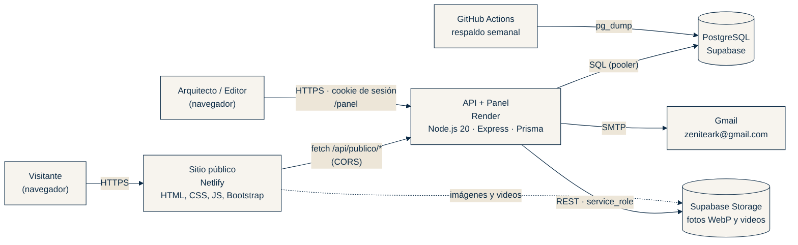

# Zenite Web

Sitio web de **Zenite Arquitectura SAS** (Tunja, Boyacá) con panel de administración, base de datos y cotizador de 3 pestañas.

| Parte | Tecnología | Dónde se publica |
|---|---|---|
| Sitio público | HTML5, CSS3, JavaScript (módulos ES), Bootstrap 5.3, GSAP, Swiper | **Netlify** |
| API y panel de administración | Node.js 20, Express 4, Prisma 6, zod, sharp, ffmpeg, docx, nodemailer | **Render** |
| Base de datos | PostgreSQL | **Supabase** |
| Fotos y videos | Supabase Storage (bucket público de lectura) | **Supabase** |
| Correo | Gmail (SMTP con contraseña de aplicación) | Google |



## Documentación

| Documento | Para quién |
|---|---|
| [Manual de uso del panel](docs/MANUAL-PANEL.md) | El arquitecto y los editores |
| [Documentación de la API](docs/API.md) | Desarrolladores |
| [Diagrama entidad-relación](docs/DIAGRAMA-ER.md) | Desarrolladores |
| [Respaldos y recuperación](docs/RESPALDOS.md) | Administrador técnico |
| [Cambios al documento de análisis](docs/CAMBIOS-DOCUMENTO-ANALISIS.md) | Autora del documento académico |

## Estructura

```
zenite-web/
├── index.html, politica-de-datos.html, gracias.html, 404.html
├── servicios/                  7 páginas, una por tipo de proyecto
├── css/styles.css              Estilos del sitio (paleta azul noche y dorado)
├── js/
│   ├── main.js                 Punto de entrada
│   └── modules/
│       ├── api.js              Conexión con la API (lee <meta name="zenite-api">)
│       ├── contenido.js        Aplica el contenido publicado desde el panel
│       ├── cotizador.js        Cotizador modular de 3 pestañas
│       ├── formulario.js       Formulario de contacto → API (Ley 1581)
│       ├── portafolio.js, marquesina.js, videos.js, carrusel.js, navegacion.js …
│       └── categorias.js       Los 7 tipos de proyecto (copia del servidor)
├── data/contenido.json         Copia de respaldo del contenido si la API no responde
├── assets/, vendor/            Imágenes, videos y librerías locales
├── tests/                      Pruebas del sitio (npm test)
├── herramientas/               Generador de páginas y de la copia de respaldo
├── netlify.toml                Despliegue y cabeceras de seguridad del sitio
├── render.yaml                 Blueprint de Render para la API
├── .github/workflows/          Respaldo semanal de la base de datos
└── servidor/
    ├── src/
    │   ├── app.js, servidor.js, config.js, db.js
    │   ├── rutas/              publicas.js, auth.js, admin.js
    │   ├── middleware/         seguridad, sesión, CSRF, CORS, errores
    │   ├── servicios/          acceso, usuarios, contenido, medios, publicación,
    │   │                       cotizador, solicitudes, documento Word, respaldo…
    │   ├── dominio/            cálculo de precios (APU), cotización, categorías
    │   ├── seguridad/          cifrado scrypt, firmas, límites de solicitudes
    │   └── demo/               base de datos en memoria para el modo demostración
    ├── panel/                  Panel de administración (HTML + JS, accesible)
    ├── prisma/
    │   ├── schema.prisma       Modelo de datos (23 tablas)
    │   ├── migrations/         SQL de la base de datos
    │   ├── datos/              Contenido actual del sitio para migrar
    │   ├── datos-privados/     Base de precios importada del Excel (NO se sube a GitHub)
    │   └── sembrar.js          Migración del contenido y de la base de precios
    ├── herramientas/           importar_excel.py, crear-usuario.js, respaldo.js
    └── pruebas/                Pruebas de la API (npm test)
```

## Probar todo en tu computador (modo demostración)

No necesita PostgreSQL ni Supabase: usa una base de datos en memoria y un correo simulado.

```bash
cd servidor
npm install
npm run demo
```

Abre <http://localhost:3000> (sitio) y <http://localhost:3000/panel> (panel).

- Usuarios: `admin@zenite.demo` (administrador) y `editor@zenite.demo` (editor), contraseña `ZeniteDemo2026`.
- El código de acceso que normalmente llega por correo aparece en **Bandeja de correo de prueba** (enlace en la pantalla de ingreso).
- Todo lo que hagas se borra al detener el servidor.

## Pruebas

```bash
npm test                 # sitio: lógica del cotizador y datos de respaldo
cd servidor && npm test  # API: acceso, permisos, CRUD, publicación, precios, cotizaciones, Ley 1581
```

La prueba `servidor/pruebas/precios.test.js` comprueba que el cálculo de precios unitarios reproduce el Excel: **2.288 de 2.288 actividades (100 %)**.

## Instalación en producción

### 1. Supabase (base de datos y archivos)

1. Crea un proyecto en <https://supabase.com> (región **East US** o la más cercana a Render).
2. **Project Settings → Database → Connection string**:
   - *Transaction pooler* (puerto 6543) → `DATABASE_URL` (agrega `?pgbouncer=true&connection_limit=5`).
   - *Session pooler / Direct* (puerto 5432) → `DIRECT_URL`.
3. **Storage → New bucket** → nombre `zenite-medios`, marcado como **Public bucket**. Límite de archivo: 50 MB.
4. **Project Settings → API** → copia `Project URL` (`SUPABASE_URL`) y la clave `service_role` (`SUPABASE_SERVICE_ROLE_KEY`). **Esta clave nunca va en el sitio público ni en GitHub.**

### 2. Correo de Gmail

1. En la cuenta `zeniteark@gmail.com` activa la **verificación en dos pasos**.
2. Ve a <https://myaccount.google.com/apppasswords>, crea una contraseña de aplicación «Zenite Web» y guárdala como `SMTP_CONTRASENA`.

### 3. Base de precios (una sola vez)

La base de precios del Excel tiene licencia de uso exclusivo: se importa a la base de datos privada y **no se sube a GitHub** (`prisma/datos-privados/` está en `.gitignore`).

```bash
cd servidor
pip install openpyxl
python3 herramientas/importar_excel.py "/ruta/COTIZADOR__BASE_DE_PRECIOS_A_TODO_COSTO.xlsx"
```

### 4. Migrar la base de datos y el contenido actual

Desde tu computador, con un archivo `servidor/.env` basado en [`.env.ejemplo`](servidor/.env.ejemplo):

```bash
cd servidor
npm install
npx prisma migrate deploy      # crea las 23 tablas
npm run db:sembrar             # sube fotos y videos actuales, textos, precios y publica la versión 1
npm run usuario:crear -- --nombre "Daniel Camilo Brand Peña" --correo zeniteark@gmail.com --rol ADMINISTRADOR
```

El último comando envía al correo un enlace para crear la contraseña del primer administrador.

### 5. Render (API y panel)

1. Sube el repositorio a GitHub (privado).
2. En Render: **New → Blueprint** y elige el repositorio; se usa [`render.yaml`](render.yaml) (servicio `zenite-api`, carpeta `servidor`). Plan recomendado: **Starter** (no se duerme; el plan gratuito tarda hasta un minuto en despertar).
3. Completa las variables marcadas como `sync: false`:

| Variable | Valor |
|---|---|
| `URL_API` | `https://zenite-api.onrender.com` (o tu dominio, p. ej. `https://panel.zenitearquitectura.co`) |
| `URL_SITIO` | Dirección del sitio en Netlify |
| `ORIGENES_PERMITIDOS` | La misma dirección del sitio (varias separadas por coma) |
| `DATABASE_URL`, `DIRECT_URL` | De Supabase |
| `SUPABASE_URL`, `SUPABASE_SERVICE_ROLE_KEY` | De Supabase |
| `SMTP_USUARIO`, `SMTP_CONTRASENA` | Gmail |

`SECRETO_SESIONES` lo genera Render. El servidor no arranca en producción si falta alguna variable obligatoria.

Al desplegar se ejecuta `npm ci && npx prisma migrate deploy`; las migraciones nuevas se aplican solas.

### 6. Netlify (sitio público)

1. **Add new site → Import from Git** → mismo repositorio, carpeta de publicación `.` (ya definida en `netlify.toml`).
2. Si la API no quedó en `https://zenite-api.onrender.com`, cambia esa dirección en:
   - `index.html` → `<meta name="zenite-api" content="…">`
   - `netlify.toml` → `Content-Security-Policy` (`connect-src`, `img-src`, `media-src`).
3. Conecta el dominio y activa HTTPS.

### 7. Respaldos

Agrega el secreto `DIRECT_URL` en **GitHub → Settings → Secrets and variables → Actions**. El flujo [`respaldo-semanal.yml`](.github/workflows/respaldo-semanal.yml) guarda una copia cada domingo. Detalles en [docs/RESPALDOS.md](docs/RESPALDOS.md).

## Variables de entorno

Todas están documentadas en [`servidor/.env.ejemplo`](servidor/.env.ejemplo).

## Seguridad y datos personales

- Contraseñas con **scrypt**; segundo factor con código de 6 números por correo (10 min, 5 intentos).
- **Bloqueo de 15 minutos tras 5 intentos fallidos** y aviso por correo; recuperación de contraseña por enlace de un solo uso (30 min).
- Sesiones en cookie `HttpOnly`, `Secure`, `SameSite=Strict`; 8 horas máximo y 60 minutos de inactividad.
- Protección CSRF (cabecera propia + verificación de origen), CORS limitado al sitio, límites de solicitudes por IP, cabeceras de seguridad y CSP estricta.
- **Ley 1581 de 2012**: autorización obligatoria, versión de la política y fecha guardadas; IP cifrada; acceso solo para administradores; eliminación a pedido del titular y anonimización automática a los 24 meses.
- La base de precios completa nunca sale de la API: el sitio solo recibe descripciones, unidades y el resultado calculado.

## Accesibilidad

El sitio y el panel siguen **WCAG 2.1 nivel AA**: navegación completa con teclado, foco visible, contraste mínimo de 4,5:1, textos alternativos obligatorios, errores asociados a cada campo y anunciados, regiones vivas para los cambios, orden por arrastre con alternativa de botones y respeto de «reducir movimiento».
