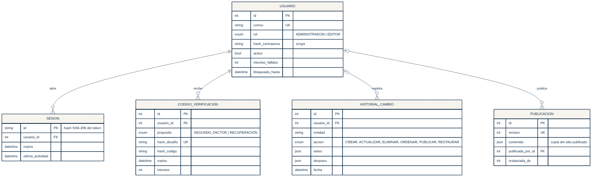
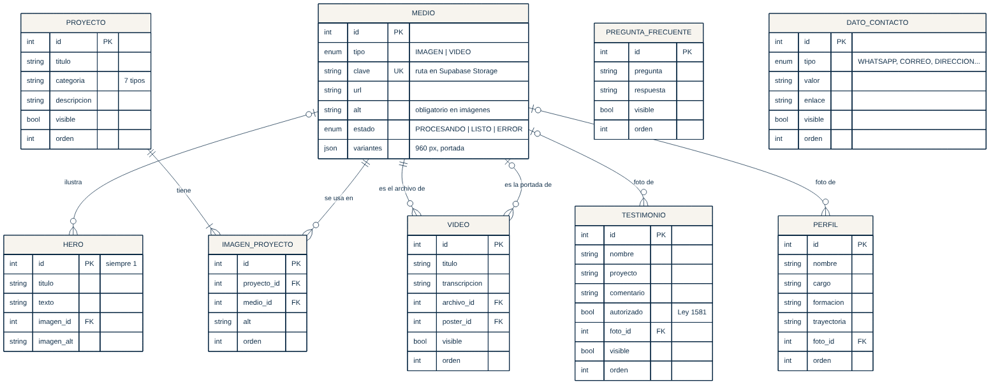
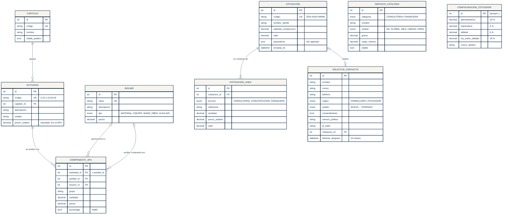

# Diagrama entidad-relación

Base de datos PostgreSQL (Supabase) definida en [`servidor/prisma/schema.prisma`](../servidor/prisma/schema.prisma); 23 tablas en `snake_case`. Notación «pata de gallo»: `||` exactamente uno, `|o` cero o uno, `|{` uno o más, `o{` cero o más.

Las fuentes Mermaid están en [`docs/diagramas/`](diagramas/) y las imágenes en [`docs/img/`](img/) (se regeneran con `mmdc -i archivo.mmd -o ../img/archivo.png -b white -s 2`).

## 1. Usuarios, acceso y auditoría

- `sesion.id` y `codigo_verificacion.hash_desafio` guardan **hashes**: aunque alguien lea la base no puede usar un token.
- `publicacion.contenido` es una copia JSON completa de lo publicado; restaurar una versión crea otra nueva con `restaurada_de`.

## 2. Contenido del sitio y medios

- `hero` tiene una sola fila (`id = 1`).
- `imagen_proyecto` resuelve la relación muchos a muchos entre `proyecto` y `medio` y guarda el **orden** y el **texto alternativo** de cada foto en ese proyecto.
- Un `medio` en uso no se puede borrar (`ON DELETE RESTRICT` en fotos de proyectos y archivos de video).
- `pregunta_frecuente` y `dato_contacto` son independientes.
- Todas las secciones tienen `visible` (ocultar sin borrar) y `orden` (arrastrar).

## 3. Base de precios, cotizaciones y solicitudes

- `componente_apu` pertenece **o** a una actividad **o** a un insumo auxiliar (restricción `CHECK`). Un insumo auxiliar (p. ej. «Cuadrilla 1 oficial + 1 ayudante») tiene su propio análisis.
- `actividad.precio_unitario` se recalcula con el APU cada vez que cambia un insumo.
- `cotizacion` guarda los porcentajes AIU aplicados en `parametros` y sus líneas con los precios del momento: cambiar precios después no altera cotizaciones ya enviadas.
- `solicitud_contacto` guarda la autorización de datos (Ley 1581): `consentimiento`, `version_politica`, `fecha_consentimiento`, `ip_hash` y `eliminar_despues` (24 meses).

## Tabla de relaciones

| Entidad A | Relación | Cardinalidad | Entidad B |
|---|---|---|---|
| usuario | abre | 1 : 0..N | sesion |
| usuario | recibe | 1 : 0..N | codigo_verificacion |
| usuario | registra | 0..1 : 0..N | historial_cambio |
| usuario | publica | 0..1 : 0..N | publicacion |
| medio | ilustra | 0..1 : 0..N | hero |
| proyecto | tiene | 1 : 1..N | imagen_proyecto |
| medio | se usa en | 1 : 0..N | imagen_proyecto |
| medio | es el archivo de | 1 : 0..N | video |
| medio | es la portada de | 0..1 : 0..N | video |
| medio | es la foto de | 0..1 : 0..N | testimonio, perfil |
| capitulo | agrupa | 1 : 0..N | actividad |
| actividad | se analiza con | 1 : 0..N | componente_apu |
| insumo | aporta precio a | 0..1 : 0..N | componente_apu |
| insumo (auxiliar) | se compone de | 0..1 : 0..N | componente_apu |
| cotizacion | se compone de | 1 : 1..N | cotizacion_linea |
| cotizacion | origina | 0..1 : 0..1 | solicitud_contacto |
