# Manual de uso del panel de administración

Panel de Zenite Web para el arquitecto y su equipo. Dirección: **`https://zenite-api.onrender.com/panel`** (o el dominio que configuren).

> **Regla de oro**: lo que cambias en el panel se guarda como **borrador**. El sitio solo cambia cuando un administrador pulsa **Publicar ahora**. Antes de publicar puedes revisar todo con la **vista previa**.
> Excepción: los **precios del cotizador** se aplican de inmediato.

## Contenido

1. [Roles y permisos](#1-roles-y-permisos)
2. [Ingresar](#2-ingresar)
3. [El tablero y el menú](#3-el-tablero-y-el-menú)
4. [Portada del sitio](#4-portada-del-sitio)
5. [Portafolio, videos, testimonios, preguntas, contacto y perfil](#5-secciones-del-sitio)
6. [Fotos y videos](#6-fotos-y-videos)
7. [Vista previa y publicación](#7-vista-previa-y-publicación)
8. [Precios del cotizador](#8-precios-del-cotizador)
9. [Solicitudes de clientes (Ley 1581)](#9-solicitudes-de-clientes-ley-1581)
10. [Cotizaciones](#10-cotizaciones)
11. [Usuarios](#11-usuarios)
12. [Historial de cambios](#12-historial-de-cambios)
13. [Respaldos](#13-respaldos)
14. [Mi cuenta](#14-mi-cuenta)
15. [Accesibilidad del panel](#15-accesibilidad-del-panel)
16. [Problemas frecuentes](#16-problemas-frecuentes)

---

## 1. Roles y permisos

| Acción | Editor | Administrador |
|---|:-:|:-:|
| Editar portada, portafolio, videos, testimonios, preguntas, contacto y perfil | Sí | Sí |
| Subir fotos y videos; abrir la vista previa | Sí | Sí |
| Publicar cambios y restaurar versiones | No | Sí |
| Precios del cotizador y cotizaciones | No | Sí |
| Solicitudes de clientes (datos personales) | No | Sí |
| Usuarios, historial de cambios y respaldos | No | Sí |

El editor está pensado para quien actualiza contenido (por ejemplo, un asistente o quien maneja las redes). El administrador es el arquitecto: revisa y publica, maneja precios y atiende clientes.

## 2. Ingresar

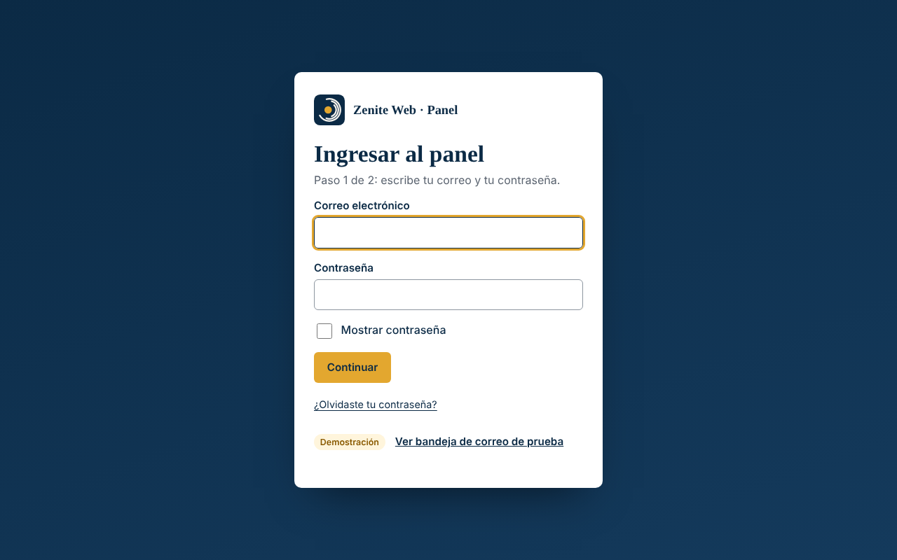

1. Escribe tu **correo** y tu **contraseña** y pulsa **Continuar**.
2. Te llega un correo con un **código de 6 números** (vence en 10 minutos). Escríbelo y pulsa **Entrar**.

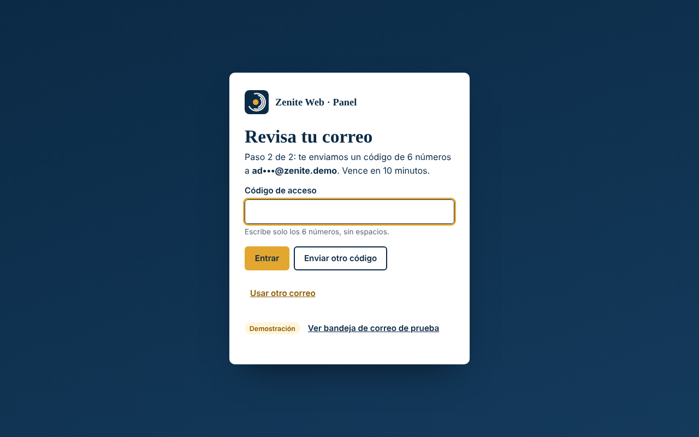

- Si no llega, revisa la carpeta de spam o pulsa **Enviar otro código** (el anterior deja de servir).
- **Después de 5 contraseñas incorrectas** el acceso se bloquea 15 minutos y te avisamos por correo. Puedes esperar, pedir a un administrador que te desbloquee o usar **¿Olvidaste tu contraseña?**.
- **¿Olvidaste tu contraseña?** te envía un enlace de un solo uso que vence en 30 minutos.
- Por seguridad la sesión se cierra tras **60 minutos sin actividad** o 8 horas en total.

La contraseña debe tener mínimo 10 caracteres, con al menos una letra y un número. Usa una frase que recuerdes, por ejemplo `MiCasaEnTunja2026`.

## 3. El tablero y el menú

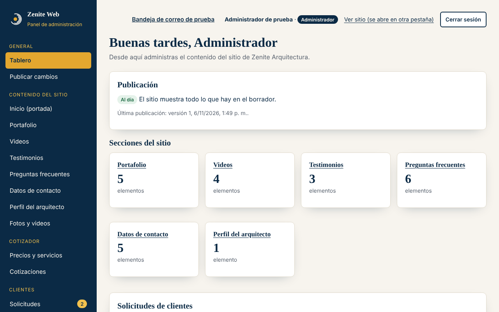

- El **tablero** muestra si hay cambios sin publicar, cuántos elementos tiene cada sección y (administradores) las solicitudes nuevas.
- El **menú** de la izquierda agrupa las secciones. En el celular se abre con el botón **Menú** y se cierra con **Esc**.
- Arriba a la derecha: tu nombre y rol, **Ver sitio** y **Cerrar sesión**.
- La insignia junto a **Solicitudes** indica cuántas hay nuevas.

## 4. Portada del sitio

**Contenido del sitio → Inicio (portada)**

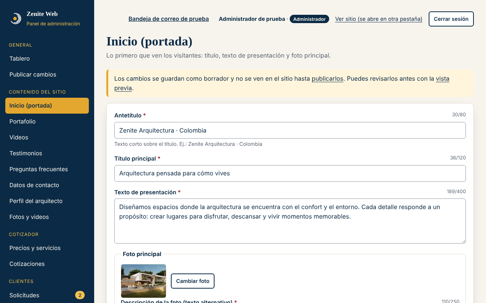

Cambia el antetítulo, el título, el texto de presentación, la **foto principal** y el pie de foto. Pulsa **Guardar cambios**.

La foto necesita su **descripción (texto alternativo)**: es lo que escucha una persona ciega con lector de pantalla. Describe lo que se ve, no repitas el título. Ejemplo: «Render de una casa campestre con terrazas de madera, basamento en ladrillo y jardín al atardecer».

## 5. Secciones del sitio

Portafolio, Videos, Testimonios, Preguntas frecuentes, Datos de contacto y Perfil del arquitecto funcionan igual:

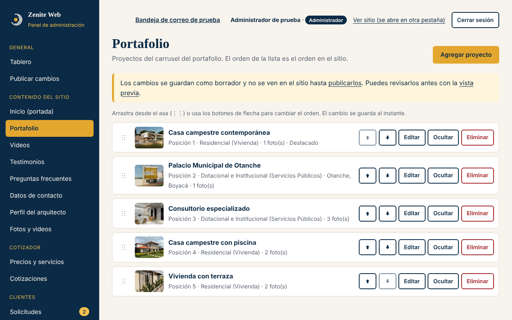

| Quiero… | Cómo |
|---|---|
| Agregar | Botón amarillo **Agregar …** arriba a la derecha |
| Editar | **Editar** en la fila |
| Cambiar el orden | Arrastra desde el asa **⋮⋮** a la izquierda, **o** usa los botones **↑** y **↓** (con teclado o en el celular). El orden se guarda al instante y es el mismo del sitio. |
| Ocultar sin borrar | **Ocultar**. La fila queda rayada con la etiqueta «Oculto en el sitio». **Mostrar** la vuelve a publicar. |
| Eliminar | **Eliminar** y confirma. No se puede deshacer; si dudas, mejor oculta. |

Los campos con **\*** son obligatorios. Si falta algo, aparece un recuadro rojo arriba con la lista de errores: pulsa cada uno para ir al campo.

### Portafolio (proyectos)

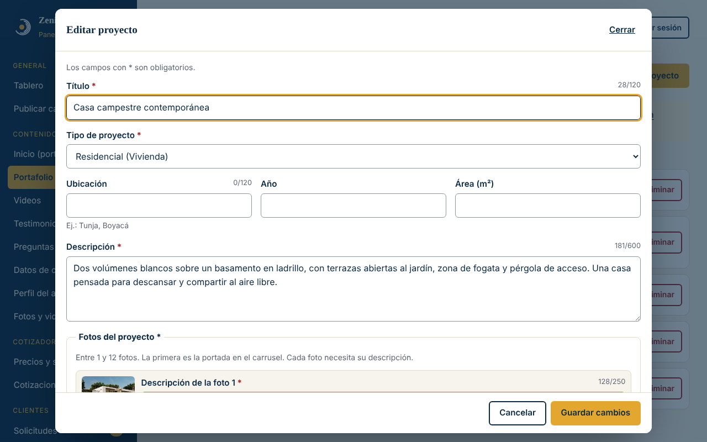

- **Tipo de proyecto**: uno de los 7 tipos (Residencial, Comercial y de Negocios, Dotacional e Institucional, Recreativo y Deportivo, Industrial y Logística, Intervenciones sobre lo Existente, Urbanismo y Territorio).
- Ubicación, año y área son opcionales.
- **Fotos del proyecto**: entre 1 y 12. **Agregar fotos** abre la biblioteca, donde puedes elegir varias o subir nuevas. Cada foto tiene su propia descripción. La primera es la portada del carrusel; usa **Subir** y **Bajar** para ordenarlas.
- **Proyecto destacado**: lo resalta en el sitio.
- Publica solo proyectos con autorización del cliente.

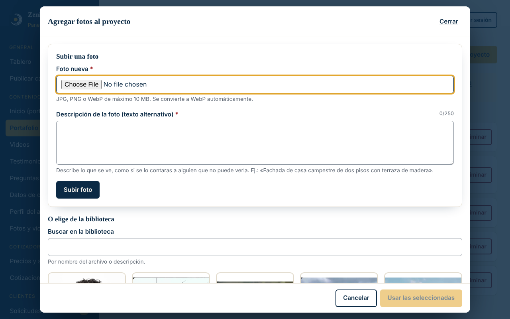

### Videos

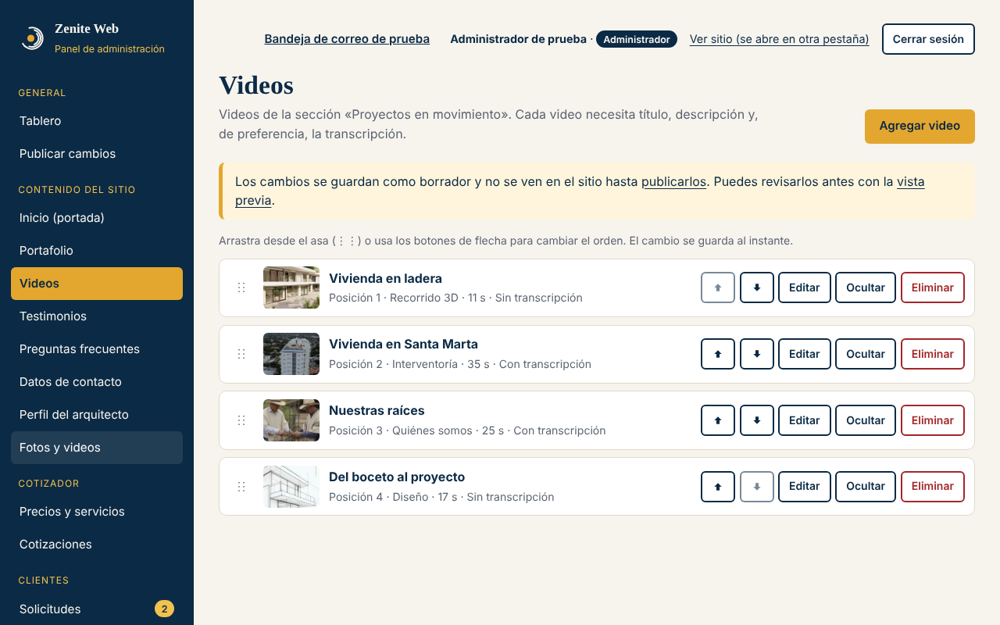

Título, etiqueta (p. ej. «Recorrido 3D», «Obra»), descripción, **archivo de video** y portada opcional. Escribe la **transcripción** o una descripción del audio: la necesitan las personas sordas y quienes ven el video sin sonido.

### Testimonios

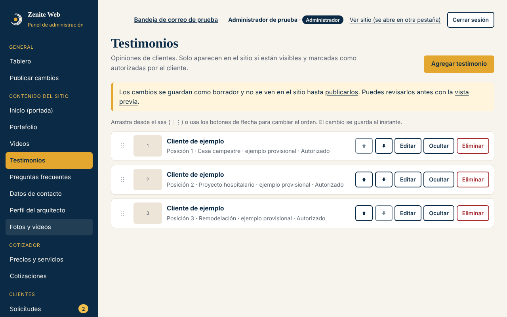

Nombre, proyecto, ciudad, comentario y foto opcional. **Solo aparecen en el sitio si marcas «La persona autorizó publicar su nombre, comentario y foto»** (Ley 1581). Guarda el soporte de esa autorización (un correo o mensaje de WhatsApp del cliente). Los tres testimonios actuales son **ejemplos provisionales**: reemplázalos por reales.

### Preguntas frecuentes, Datos de contacto y Perfil

- **Preguntas**: pregunta y respuesta en lenguaje sencillo.
- **Datos de contacto**: tipo (WhatsApp, teléfono, correo, Instagram, dirección, horario u otro), etiqueta, valor que se muestra y enlace opcional (`https://wa.me/57…`, `mailto:…`, `tel:…`). El enlace de WhatsApp también actualiza el botón flotante del sitio.
- **Perfil del arquitecto**: nombre, cargo, foto, lema (se usa como título de la sección «Nosotros»), misión, formación, trayectoria y experiencia.

## 6. Fotos y videos

**Contenido del sitio → Fotos y videos**

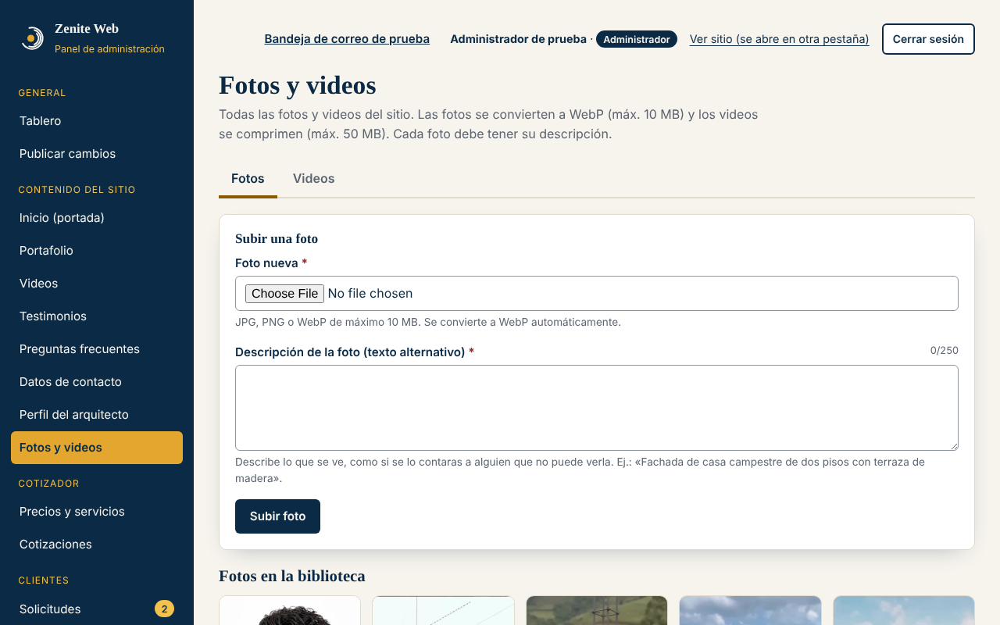

- **Fotos**: JPG, PNG o WebP de máximo **10 MB**. Se convierten automáticamente a **WebP** (formato liviano) en dos tamaños. La descripción es **obligatoria**.
- **Videos**: MP4, MOV o WebM de máximo **50 MB**. Se **comprimen** automáticamente; mientras tanto aparecen como «Comprimiendo…» (unos minutos). Cuando digan «Listo» ya puedes usarlos.
- **Detalles** muestra dónde se usa cada archivo y permite corregir su descripción.
- No puedes eliminar un archivo que esté en uso: el aviso te dice en qué sección quitarlo primero.

Consejo: antes de subir, recorta las fotos horizontales a 1920 px de ancho y los videos a menos de 1 minuto.

## 7. Vista previa y publicación

**General → Publicar cambios**

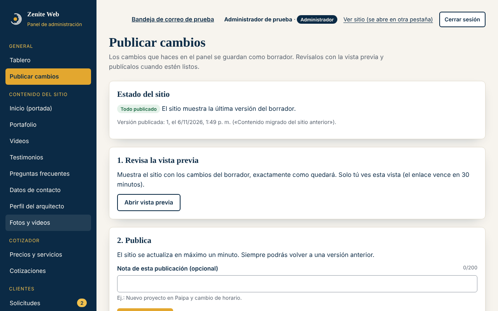

1. **Estado del sitio** indica si hay cambios sin publicar.
2. **Abrir vista previa**: abre el sitio con el borrador en otra pestaña, con una franja amarilla «Vista previa del borrador». Solo tú la ves y el enlace dura 30 minutos.
3. **Publicar ahora** (administradores): escribe una nota opcional («Nuevo proyecto en Paipa») y publica. El sitio se actualiza en máximo un minuto.
4. **Versiones publicadas**: lista de publicaciones anteriores. **Restaurar** vuelve a publicar una versión antigua si algo salió mal (el borrador no cambia).

Los editores pueden preparar y revisar, pero deben pedirle al administrador que publique.

## 8. Precios del cotizador

**Cotizador → Precios y servicios** (solo administradores). Los cambios aplican **de inmediato** en el cotizador del sitio. Los visitantes nunca ven la base de precios completa: solo los nombres y, al calcular, el valor de lo que eligieron.

### Servicios (pestañas 1 y 3 del cotizador)

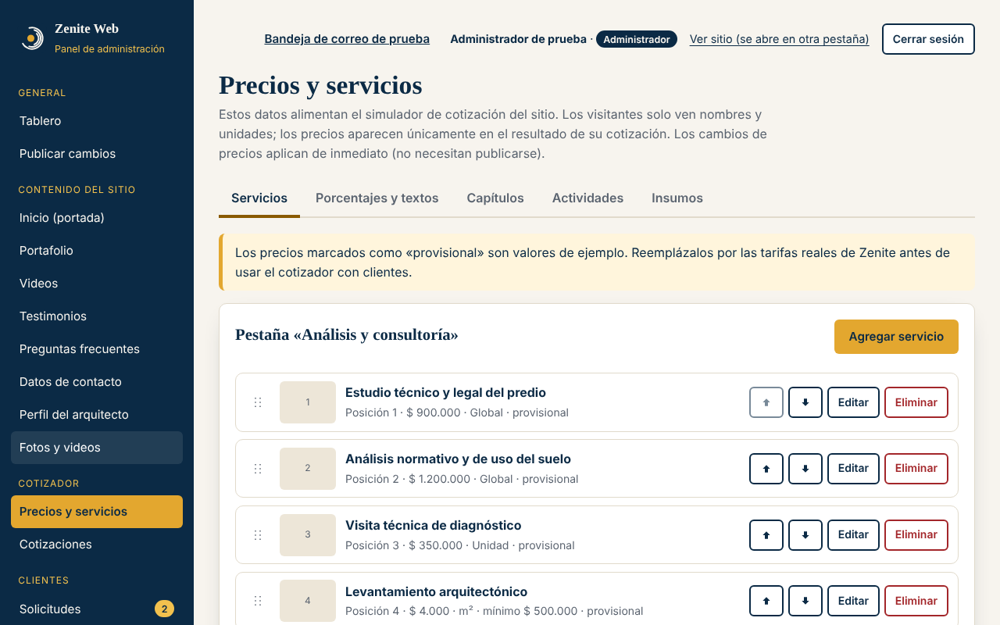

Servicios de **Análisis y consultoría** y de **Financiera y costos**: nombre, descripción, cómo se cobra (por m², global, por mes, por unidad o por hora), precio, cargo mínimo opcional (útil en cobros por m²) y si se muestra. Ordénalos igual que las demás listas.

> Los precios marcados como **provisional** son valores de ejemplo puestos al crear el sistema. **Reemplázalos por las tarifas reales** y desmarca «provisional».

### Porcentajes y textos

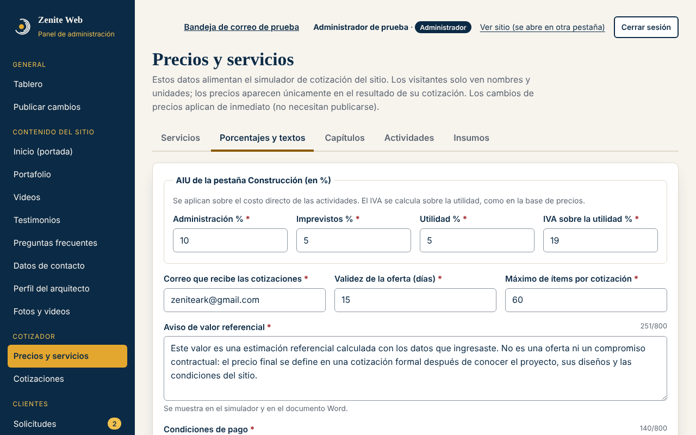

- **AIU** de la pestaña Construcción: Administración (10 %), Imprevistos (5 %), Utilidad (5 %) e IVA sobre la utilidad (19 %), tomados de la base de precios.
- Correo que recibe las cotizaciones (por defecto `zeniteark@gmail.com`), validez de la oferta, máximo de ítems por cotización, aviso de valor referencial, condiciones y datos de pago que van en el Word.

### Capítulos, actividades e insumos (pestaña 2: Construcción)

La base tiene **29 capítulos, 2.288 actividades y 2.156 insumos** importados del Excel «Base de precios a todo costo».

- **Capítulos**: puedes ocultar un capítulo completo del cotizador sin borrarlo.
- **Actividades**: busca por código o descripción. **Ver / editar** muestra sus datos y su **análisis de precios unitarios (APU)**: cada insumo con su cantidad (rendimiento). Puedes agregar o quitar insumos, cambiar cantidades y pulsar **Guardar análisis y recalcular**. Desmarca «Disponible en el simulador» para que una actividad no aparezca en el sitio.

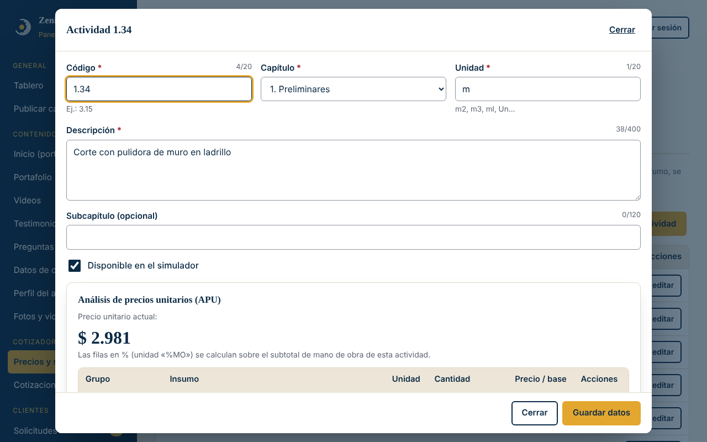

- **Insumos**: materiales, equipos, mano de obra, cuadrillas y transportes. **Al cambiar el precio de un insumo se recalculan solas todas las actividades que lo usan**, también a través de cuadrillas o morteros (auxiliares). El aviso te dice cuántas cambiaron.

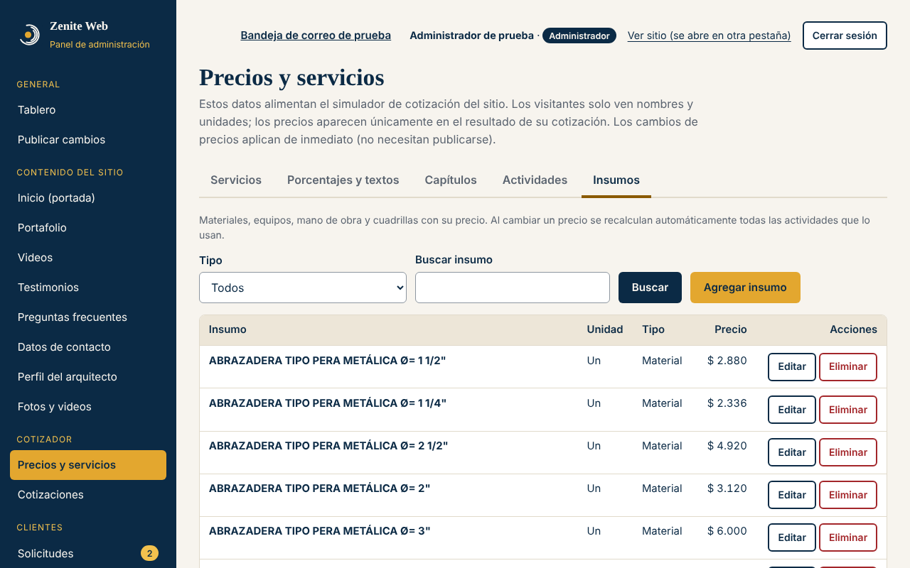

Recomendación: actualiza los precios de insumos cada vez que llegue una nueva versión de la base de precios o al menos cada trimestre.

## 9. Solicitudes de clientes (Ley 1581)

**Clientes → Solicitudes** (solo administradores)

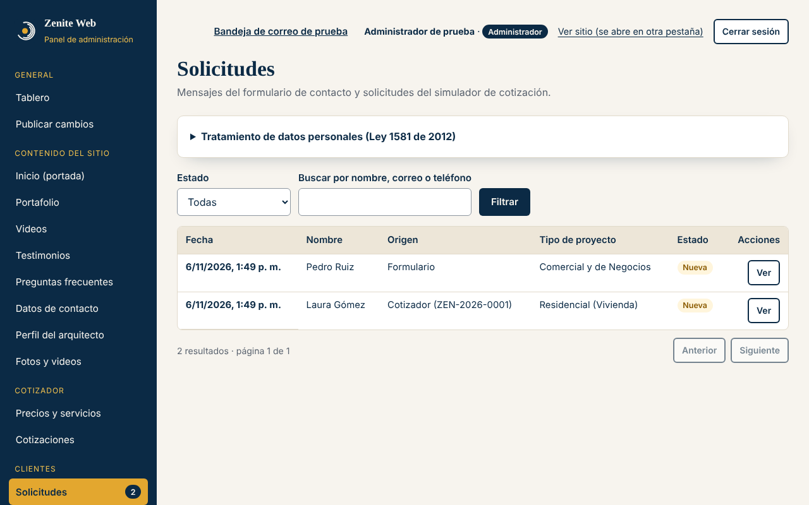

Aquí llegan los mensajes del formulario de contacto y las solicitudes del cotizador. Filtra por estado o busca por nombre, correo o teléfono.

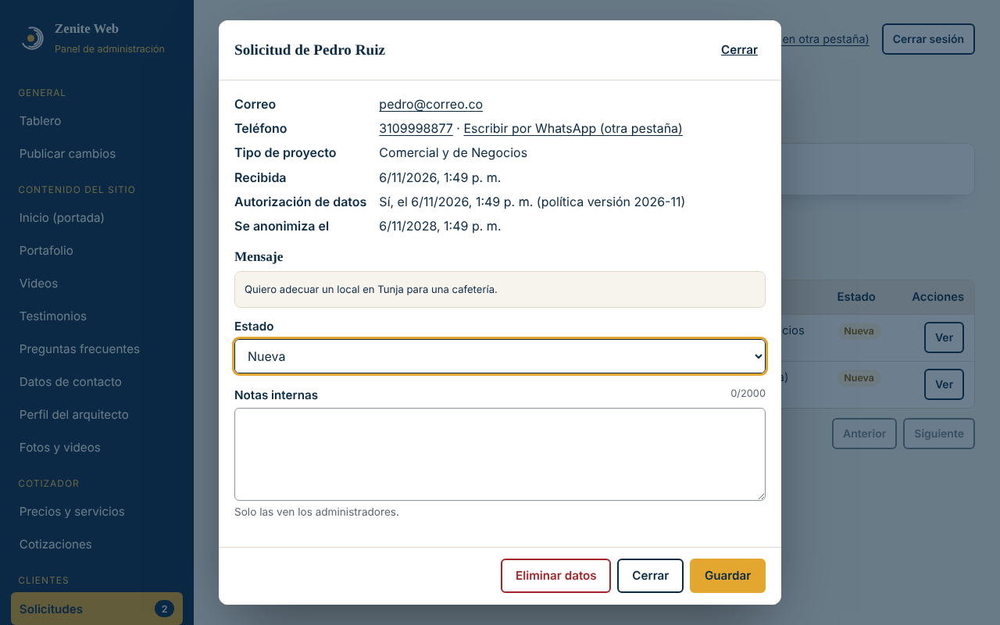

- **Ver** muestra los datos, la autorización (fecha y versión de la política aceptada), el mensaje y, si viene del cotizador, el botón para **descargar el Word**.
- Cambia el **estado**: Nueva → En revisión → Contactada → Cerrada (o Descartada). Agrega **notas internas**.
- Desde el detalle puedes escribir al cliente por correo o WhatsApp.

Obligaciones de la Ley 1581 de 2012:

- Usa los datos solo para responder la solicitud y dar seguimiento al proyecto.
- Si la persona pide conocer, corregir o suprimir sus datos, respóndele en máximo 15 días hábiles. Para suprimirlos usa **Eliminar datos** (también borra su cotización).
- A los 24 meses los datos se anonimizan automáticamente.
- No descargues ni compartas esta información fuera del panel.

## 10. Cotizaciones

**Cotizador → Cotizaciones** (solo administradores)

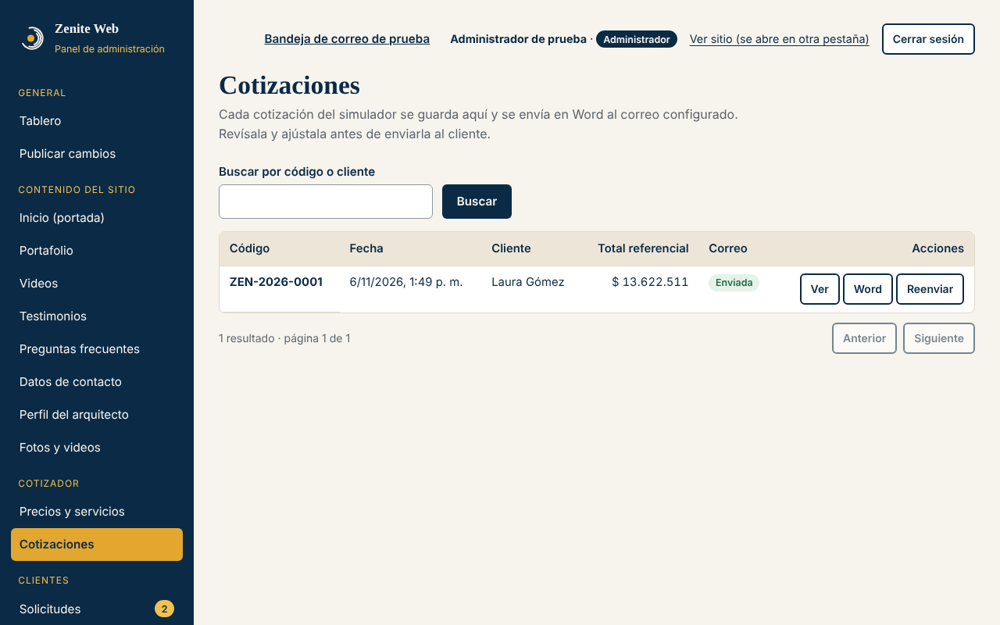

Cada vez que un visitante pide su cotización desde el sitio:

1. El sistema **recalcula** los valores con los precios vigentes.
2. Guarda la cotización con un número **ZEN-AAAA-NNNN**.
3. Genera el **documento Word** con el formato de cotización de Zenite (membrete, alcance, propuesta económica por secciones, AIU, valor en letras, condiciones y espacio para firmas).
4. Lo envía a **zeniteark@gmail.com**.

El Word sale marcado como «Borrador generado desde el sitio web»: **revísalo, ajusta el tiempo de ejecución y firma antes de enviarlo al cliente**. En la lista puedes ver el detalle, descargar el Word de nuevo o **reenviar** el correo si falló (columna «Correo»).

## 11. Usuarios

**Administración → Usuarios** (solo administradores)

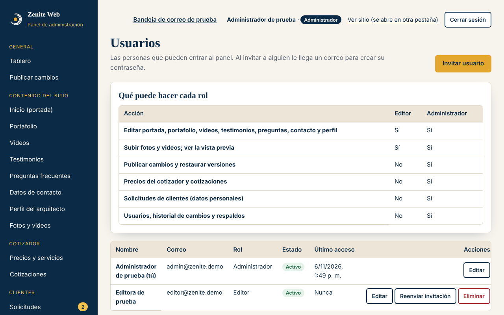

- **Invitar usuario**: nombre, correo y rol. Le llega un correo para crear su contraseña (enlace de 72 horas). Si no lo usó, **Reenviar invitación**.
- **Editar**: cambiar nombre, correo, rol o desactivar (pierde el acceso sin borrarse).
- **Desbloquear**: si alguien quedó bloqueado por intentos fallidos.
- Siempre debe quedar al menos un administrador activo y no puedes desactivarte a ti mismo.

## 12. Historial de cambios

**Administración → Historial de cambios**

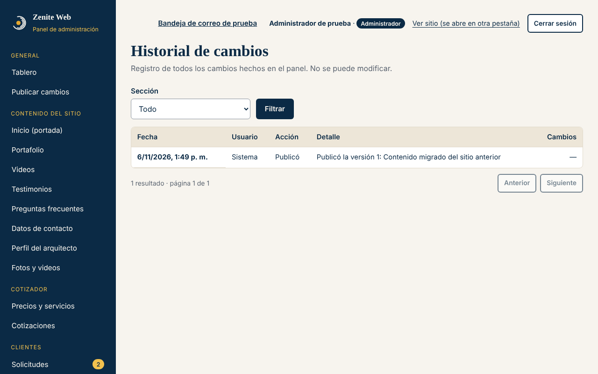

Registro de quién cambió qué y cuándo (crear, editar, eliminar, ordenar, publicar, restaurar). **Ver** muestra cada campo antes y después. No se puede modificar.

## 13. Respaldos

**Administración → Respaldos**

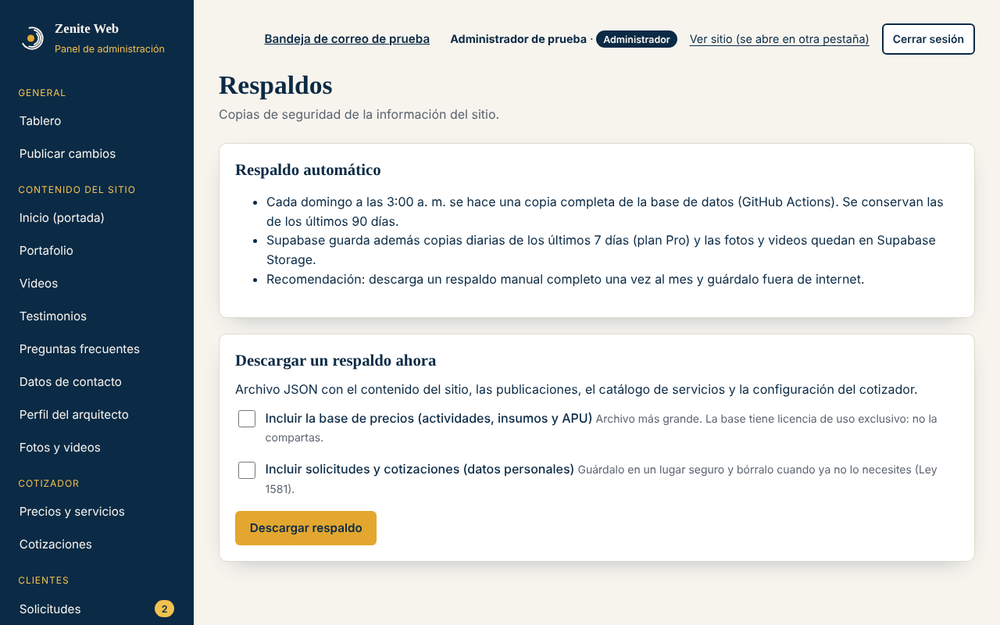

- Cada domingo se hace una copia automática de toda la base de datos (se guardan 90 días).
- **Descargar respaldo**: copia manual en un archivo. Recomendación: una vez al mes, guardada en un disco externo. Si incluyes solicitudes (datos personales) guárdala en un lugar seguro.

Más detalles técnicos en [RESPALDOS.md](RESPALDOS.md).

## 14. Mi cuenta

**Mi cuenta → Cambiar contraseña**: escribe la actual y la nueva dos veces. Las demás sesiones abiertas se cierran.

## 15. Accesibilidad del panel

El panel cumple WCAG 2.1 AA:

- Todo se maneja con **teclado**: **Tab** avanza, **Shift + Tab** retrocede, **Enter** o **Espacio** activan, **Esc** cierra ventanas y el menú, las **flechas** cambian de pestaña.
- El orden de las listas se puede cambiar con los botones **↑ ↓** además de arrastrar; cada movimiento se anuncia («quedó en la posición 2 de 5»).
- Al cambiar de sección el foco va al título; los errores se anuncian y se enlazan a su campo.
- Funciona en celular y tableta (menú desplegable).

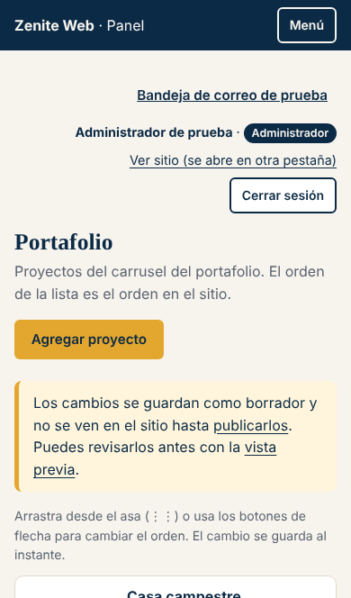

## 16. Problemas frecuentes

| Problema | Solución |
|---|---|
| No me llega el código | Revisa spam; pulsa «Enviar otro código». Verifica que el correo esté bien escrito. |
| «Tu acceso está bloqueado» | Espera 15 minutos, usa «¿Olvidaste tu contraseña?» o pide a un administrador que te desbloquee. |
| Cambié algo y el sitio no cambió | Falta **publicar** (o espera un minuto y recarga el sitio). |
| «Describe la foto…» | La descripción de cada foto es obligatoria (mínimo 8 caracteres). |
| El video dice «Comprimiendo…» | Espera unos minutos; la lista se actualiza sola. Si dice «Error», súbelo de nuevo (MP4 de menos de 50 MB). |
| «No se puede eliminar porque se usa en…» | Quita el archivo de esa sección primero, o reemplázalo. |
| El cotizador del sitio muestra un precio raro | Revisa el APU de la actividad y los precios de sus insumos en **Precios y servicios**. |
| «Tu sesión terminó» | Vuelve a ingresar; la sesión se cierra tras 60 minutos sin actividad. |
